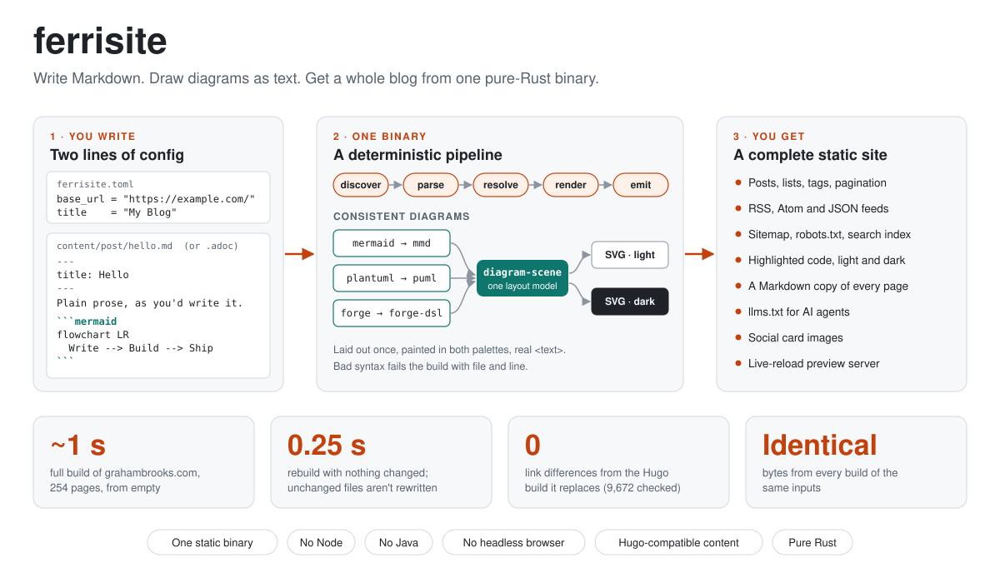
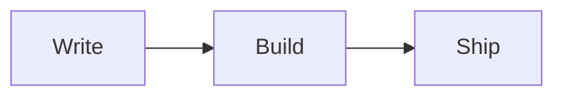

# ferrisite

A pure-Rust static site generator for technical blogs. You write Markdown or
AsciiDoc, with diagrams as text, and one binary turns it into a complete,
fast, agent-readable site.



## Why

I built ferrisite to replace Hugo for [grahambrooks.com](https://www.grahambrooks.com).
Hugo served the site well, but I kept hitting three problems:

- **Too much configuration.** A theme, its modules, a Sass pipeline and a pile
  of layouts, all to publish posts. In ferrisite a site needs two lines of
  config. Built-in templates cover posts, lists, tags, feeds and a 404 page
  until you want your own.
- **Diagrams that didn't match.** Mermaid ran in the reader's browser from a
  CDN, PlantUML needed Java, and the two looked nothing alike. Switching the
  theme meant reloading the page to redraw them. ferrisite renders Mermaid,
  PlantUML and [forge](https://github.com/grahambrooks/forge) diagrams at
  build time with pure-Rust renderers I also maintain
  ([`mmd`](https://github.com/grahambrooks/mmd),
  [`puml`](https://github.com/grahambrooks/puml),
  [`forge-dsl`](https://github.com/grahambrooks/forge)). All three lay out
  through one scene model,
  [`diagram-scene`](https://github.com/grahambrooks/diagram-scene), so every
  diagram shares the same fonts, line weights and colours. Each is drawn once
  in a light palette and once in a dark one, and the page's theme switch
  shows the right copy with CSS. They're inline SVG with real `<text>`, so
  they're searchable and readable without JavaScript.
- **Silent failures.** An unsupported diagram or a broken `ref` link fails
  the build with its file and line. Nothing is quietly dropped.

The same inputs always produce the same bytes, and the build checks its own
links. Before the site's deploy switches over, a parity check compares the
ferrisite build of grahambrooks.com with Hugo's: every URL, redirect and
feed item matches, with no differences across 9,672 links.

ferrisite is built for one site first. Features exist because a real blog
uses them. [DESIGN.md](DESIGN.md) records the scope and the things it
deliberately doesn't do (no plugin API, no Sass, no Hugo layouts).

## Install

### Homebrew (macOS and Linux)

The formula lives in this repository, so the tap needs its URL. Since
Homebrew 6, a third-party formula must be trusted before it will load:

```bash
brew trust --formula grahambrooks/ferrisite/ferrisite
brew tap grahambrooks/ferrisite https://github.com/grahambrooks/ferrisite
brew install grahambrooks/ferrisite/ferrisite
```

Each release updates `Formula/ferrisite.rb` from its published checksums, so
`brew upgrade ferrisite` picks up new versions.

### Download a release binary

Each [GitHub release](https://github.com/grahambrooks/ferrisite/releases)
has a tarball per platform holding the single `ferrisite` binary, plus a
`SHA256SUMS` file. The platforms are `aarch64-apple-darwin`,
`x86_64-apple-darwin`, `aarch64-unknown-linux-gnu` and
`x86_64-unknown-linux-gnu`.

```bash
# Latest release tag, for example v2026.11.1
TAG=$(curl -sL https://api.github.com/repos/grahambrooks/ferrisite/releases/latest \
      | grep -m1 '"tag_name"' | cut -d'"' -f4)
TARGET=aarch64-apple-darwin   # pick your platform from the list above
FILE="ferrisite-${TAG}-${TARGET}.tar.gz"
BASE="https://github.com/grahambrooks/ferrisite/releases/download/${TAG}"

curl -LO "${BASE}/${FILE}"
curl -LO "${BASE}/SHA256SUMS"
grep " ${FILE}\$" SHA256SUMS | shasum -a 256 -c -   # expect: OK

tar xzf "${FILE}"
sudo install -m 755 ferrisite /usr/local/bin/      # or anywhere on your PATH
ferrisite --version
```

With the [GitHub CLI](https://cli.github.com) the download is one line:

```bash
gh release download -R grahambrooks/ferrisite -p "*-aarch64-apple-darwin.tar.gz" -p SHA256SUMS
```

### From source

Needs Rust 1.99 or later; `rust-toolchain.toml` pins the version.

```bash
cargo install --git https://github.com/grahambrooks/ferrisite
```

## Quick start

~~~bash
mkdir -p my-blog/content/post && cd my-blog

cat > ferrisite.toml <<'EOF'
base_url = "https://example.com/"
title = "My Blog"
EOF

cat > content/post/hello.md <<'EOF'
---
title: Hello
date: 2026-11-01
---
My first post.


EOF

ferrisite serve     # http://localhost:1313, rebuilds and reloads on save
ferrisite build     # writes the site to public/
~~~

That's the whole setup. The build writes:

| Output | Files |
|---|---|
| Pages | `index.html` for home, each post, each section with pagination, each tag |
| Feeds | `index.xml` (RSS), `atom.xml`, `feed.json`, plus an RSS feed per section and term |
| Discovery | `sitemap.xml`, `robots.txt`, `index.json` (search index), `404.html` |
| For AI agents | an `index.md` copy of every page, `llms.txt` and `llms-full.txt` |
| Assets | `css/ferrisite.css` (code highlighting and diagram light/dark rules), social cards when configured |

## Diagrams

Write diagrams in fenced code blocks (Markdown) or source blocks (AsciiDoc):

| Info string | Rendered by |
|---|---|
| `mermaid` | [`mmd`](https://github.com/grahambrooks/mmd) |
| `plantuml` or `puml` | [`puml`](https://github.com/grahambrooks/puml) |
| `forge` | [`forge-dsl`](https://github.com/grahambrooks/forge) |

To match your site's colours, override the palettes in `ferrisite.toml`:

```toml
[markup.diagram_light]
accent = "#c2410c"
background = "#ffffff"

[markup.diagram_dark]
accent = "#f0794f"
background = "#0d1117"
```

The keys are `background`, `surface`, `text`, `muted`, `line` and `accent`.
The Markdown copy of each page keeps the diagram's source rather than its
SVG, so an agent reads what the diagram means.

## Commands

| Command | What it does |
|---|---|
| `ferrisite build` | Build into `public/`. Options: `--drafts`, `--future`, `--base-url`, `--out`. Only changed files are rewritten. |
| `ferrisite serve` | Build with drafts, serve on port 1313, rebuild and reload open pages on change. |
| `ferrisite check` | Check a built site's internal links and anchors; `--agents` also checks the Markdown copies and `llms.txt`. |
| `ferrisite parity` | Compare two built sites (URLs, redirects, links, feed items). Used to prove the Hugo migration. |

## Customising

- **Templates:** put a file with the same name as a built-in
  ([`src/templates/`](src/templates)) in your site's `templates/` directory.
  Templates are [minijinja](https://docs.rs/minijinja); see
  [TEMPLATES.md](TEMPLATES.md) for the lookup order and the data each
  template receives.
- **Shortcodes:** Hugo-style `` shortcodes are templates in
  `templates/shortcodes/`. `ref`, `relref` and `highlight` are built in.
- **Content from Hugo:** frontmatter (YAML or TOML), slugs, `aliases`,
  taxonomies, summaries and heading IDs follow Hugo's rules, so content
  written for Hugo builds unchanged. Layouts don't carry over: they're
  rewritten as minijinja templates, and so are any custom shortcodes.

## Development

```bash
make check         # the CI check job: fmt --check, clippy -D warnings, test
make hooks         # install prek hooks (fast checks on commit, make check on push)
make release-dry   # show the CalVer tag `make release` would push
```

See [DESIGN.md](DESIGN.md) for the pipeline, decisions and milestones, and
[CLAUDE.md](CLAUDE.md) for the rules every change follows.

## License

MIT
